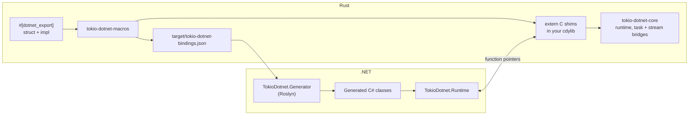
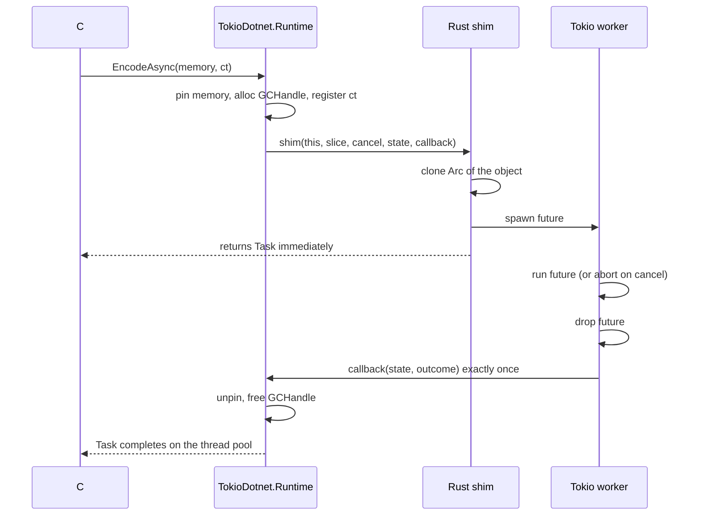
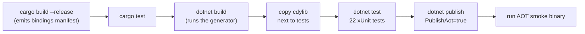

# tokio-dotnet

A zero-copy, NativeAOT-compatible bridge between **async Rust** (Tokio futures and
`futures::Stream`) and **modern .NET** (`Task<T>`, `IAsyncEnumerable<T>`, `Memory<T>`).

Annotate Rust with `#[dotnet_export]`; a Roslyn source generator emits the C# bindings at
compile time. No hand-written P/Invoke, no serialization, no runtime reflection.

> **Status:** experimental. Verified on macOS arm64 only (rustc 1.100, .NET SDK 9.0.303).
> See [docs/BUGS.md](docs/BUGS.md) and [docs/OPEN_ITEMS.md](docs/OPEN_ITEMS.md).

## Example

Rust:

```rust
use futures::Stream;
use tokio_dotnet_core::RustResult;
use tokio_dotnet_macros::dotnet_export;

#[dotnet_export]
pub struct TokenizerEngine { /* state owned on the Rust heap */ }

#[dotnet_export]
impl TokenizerEngine {
    pub fn new(vocab_json: &[u8]) -> RustResult<Self> { /* ... */ }

    /// Runs on Tokio. `text` is pinned .NET memory; the result is handed over without a copy.
    pub async fn encode_async(&self, text: &[u8]) -> RustResult<Vec<u32>> { /* ... */ }

    /// Pulled one item at a time by `await foreach`.
    pub fn stream_tokens(&self, prompt: String) -> impl Stream<Item = RustResult<u32>> { /* ... */ }
}
```

Generated C# API:

```csharp
using var engine = TokenizerEngine.Create(vocabBytes);

using IMemoryOwner<uint> tokens = await engine.EncodeAsync(inputMemory, cancellationToken);
ReadOnlySpan<uint> ids = tokens.Memory.Span;       // Rust's buffer, not a copy

await foreach (uint token in engine.StreamTokens("Hello world", cancellationToken))
    Console.WriteLine(token);                       // breaking out drops the Rust stream
```

## How it works



An async call, end to end:



Key guarantees, each covered by a test below:

- **Zero copy** in both directions: inputs are pinned, outputs are Rust buffers wrapped in `MemoryManager<T>`.
- **No use-after-free on early dispose:** every async call holds its own `Arc` of the Rust object.
- **Exactly one completion callback**, even if the Rust task is dropped.
- **Panics never cross the boundary:** they become `RustFfiException`.
- **Cancellation aborts the Rust future** rather than just abandoning the `Task`.
- **Backpressure:** streams are pulled one item per `MoveNextAsync`.

## Supported types

| Rust | C# (sync method) | C# (async / stream method) |
|---|---|---|
| `u8`…`u64`, `i8`…`i64`, `usize`, `isize`, `f32`, `f64` | matching primitive | same |
| `bool` | `bool` | same |
| `&[T]` | `ReadOnlySpan<T>` | `ReadOnlyMemory<T>` (pinned until completion; not allowed on streams) |
| `&str` | `string` | `string` (not allowed on streams) |
| `String`, `Vec<T>` parameters | `string`, `ReadOnlySpan<T>` | `string`, `ReadOnlyMemory<T>` |
| `Vec<T>` return | `IMemoryOwner<T>` | `Task<IMemoryOwner<T>>` |
| `String` return | `string` | `Task<string>` |
| `RustResult<T>` | throws `RustFfiException` on `Err` | faulted `Task` |
| `Self` / `RustResult<Self>` (no receiver) | static factory (`new` → `Create`) | — |
| `impl Stream<Item = RustResult<T>>` | — | `IAsyncEnumerable<T>` |

Methods take `&self` or no receiver. `T` in slices and vectors is a numeric primitive.

## Building and verifying

Requires Rust (stable) and the .NET 9 SDK.

```sh
./scripts/verify.sh            # everything below; SKIP_AOT=1 skips the NativeAOT step
./scripts/bench.sh             # BenchmarkDotNet suite
```



## Test results

Last full run: 2026-11-26, macOS arm64. Details for every test are in
[docs/TESTING.md](docs/TESTING.md).

| Suite | Tests | Passed | Failed |
|---|---:|---:|---:|
| Rust unit tests (`tokio-dotnet-core`) | 3 | 3 | 0 |
| .NET `ZeroCopyMemoryTests` | 5 | 5 | 0 |
| .NET `ConcurrencyAndGcTests` | 4 | 4 | 0 |
| .NET `StreamingAndCancelTests` | 8 | 8 | 0 |
| .NET `PanicSafetyTests` | 5 | 5 | 0 |
| NativeAOT smoke test (publish + run) | 1 | 1 | 0 |
| **Total** | **26** | **26** | **0** |

Benchmark, 1 MB buffer round trip (BenchmarkDotNet short run, in-process):

| Method | Mean | Ratio | Allocated |
|---|---:|---:|---:|
| Copy-in / copy-out baseline | 165.0 µs | 1.00 | 1,049,740 B |
| Zero-copy, sync | 28.8 µs | 0.17 | 56 B |
| Zero-copy, async (Tokio hop) | 46.4 µs | 0.28 | 460 B |

The baseline simulates classic `byte[]` marshalling (copy to native, call, copy back).

## Repository layout

| Path | Contents |
|---|---|
| `crates/tokio-dotnet-core` | C-ABI types, global Tokio runtime, task and stream bridges, panic containment |
| `crates/tokio-dotnet-macros` | `#[dotnet_export]`: shim generation and the bindings manifest |
| `crates/tokio-dotnet-example` | Reference cdylib: stress operations and a Hugging Face `tokenizers` wrapper |
| `dotnet/TokioDotnet.Runtime` | Safe handles, `RustMemoryManager<T>`, task bridge, async enumerator |
| `dotnet/TokioDotnet.Generator` | Roslyn incremental generator that reads the manifest |
| `dotnet/TokioDotnet.Tests` | xUnit tests and BenchmarkDotNet benchmarks |
| `dotnet/TokioDotnet.AotSmoke` | Console app published with NativeAOT by `verify.sh` |
| `docs/` | Test report, open work items, known bugs |

## Using it in your own project

There are no published packages yet. For now: depend on the two crates by path, build your
crate as a `cdylib`, then in your `.csproj` reference `TokioDotnet.Runtime`, add
`TokioDotnet.Generator` as an analyzer, add `target/tokio-dotnet-bindings.json` as
`AdditionalFiles`, and copy the native library next to your output. `TokioDotnet.Tests.csproj`
is a working template. The generated namespace is the cdylib name in PascalCase.

## License

Licensed under either of [Apache License, Version 2.0](LICENSE-APACHE) or
[MIT license](LICENSE-MIT) at your option.
