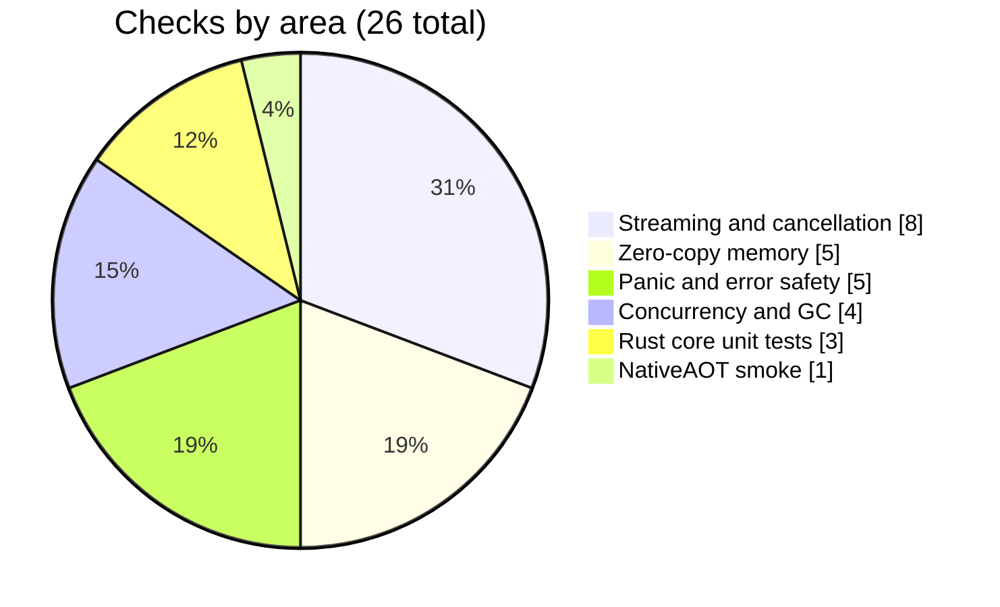
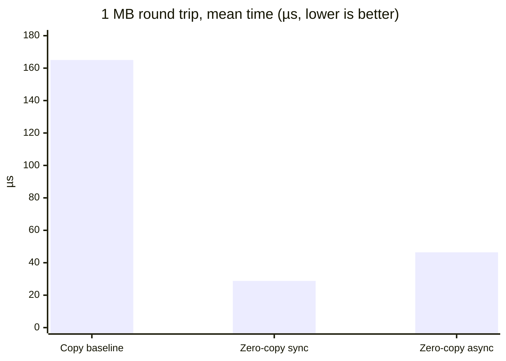

# Test report

Last full run: **2026-11-26**, macOS arm64, rustc 1.100.0, .NET SDK 9.0.303 (tests on `net9.0`),
via `./scripts/verify.sh`. Result: **26 of 26 checks passed**.

The same script runs in CI on every push ([workflow](../.github/workflows/ci.yml)):

| Platform | Rust tests | .NET tests | Quick-start sample | NativeAOT publish + run |
|---|---|---|---|---|
| Ubuntu (x64) | Pass | 22/22 | Pass | Pass |
| macOS (arm64) | Pass | 22/22 | Pass | Pass |
| Windows (x64) | Pass | 22/22 | Pass | Pass |

Results above are from the CI run on commit `9dd5f3d` (2026-11-26). Not run: .NET 8, 32-bit
targets (see [OPEN_ITEMS.md](OPEN_ITEMS.md)).

## What each area protects

```mermaid
flowchart TB
    subgraph Boundary["FFI boundary risks"]
        R1["Struct layout mismatch"]
        R2["GC moves pinned input"]
        R3["Object freed while a call is in flight"]
        R4["Callback fires 0 or 2 times"]
        R5["Rust panic unwinds into .NET"]
        R6["Cancelled work keeps running"]
        R7["Stream outlives its consumer"]
        R8["Buffer leaked or double-freed"]
    end
    R1 --> T1["LayoutParity + layout_matches_csharp"]
    R2 --> T2["GcCompactionTorture_10kConcurrentEncodes"]
    R3 --> T3["MidFlightDispose_500TasksStillComplete"]
    R4 --> T4["dropped_guard_fires_cancelled_once<br/>LiveHandles == 0 assertions"]
    R5 --> T5["AsyncPanic / SyncPanic tests"]
    R6 --> T6["TaskCancellation_AbortsRustFutureImmediately"]
    R7 --> T7["EarlyBreak_DropsRustStreamWithin50ms"]
    R8 --> T8["Output_IsTheRustBuffer_AndDisposeFreesIt"]
```

## Rust unit tests — `tokio-dotnet-core` (3/3)

| Test | Verifies | Result |
|---|---|---|
| `memory::tests::layout_matches_csharp` | Sizes and field offsets of every `#[repr(C)]` type (the same numbers are asserted in C#) | Pass |
| `task_bridge::tests::dropped_guard_fires_cancelled_once` | A dropped `CompletionGuard` fires the callback exactly once, with a cancelled outcome | Pass |
| `task_bridge::tests::spawn_resolves_ok_panic_and_cancel` | A spawned future resolves with its value, a panic becomes a panic error, a cancelled token aborts it | Pass |

## .NET tests — `TokioDotnet.Tests` (22/22, 3.2 s)

### ZeroCopyMemoryTests (5/5)

| Test | Verifies | Time | Result |
|---|---|---:|---|
| `LayoutParity` | C# struct sizes and offsets equal the Rust ones | < 1 ms | Pass |
| `HandWired_AsyncTransform_ReturnsZeroCopyMemoryOwner` | **Phase 1 gate.** A hand-written export driven through the runtime alone: buffer in, async transform on Tokio, `IMemoryOwner<byte>` out | 1 ms | Pass |
| `Input_IsPassedWithoutCopy` | The address Rust sees equals the pinned .NET array address | < 1 ms | Pass |
| `Output_IsTheRustBuffer_AndDisposeFreesIt` | Returned memory is Rust's own buffer (pointer identity, sync and async, 1 MB); `Dispose` frees it once; double dispose is safe; use after dispose throws | 222 ms | Pass |
| `EmptyBuffers_RoundTrip` | Empty spans and empty strings cross the boundary safely | < 1 ms | Pass |

### ConcurrencyAndGcTests (4/4)

| Test | Verifies | Time | Result |
|---|---|---:|---|
| `SyncCalls_RoundTrip` | Primitives, `bool`, UTF-8 strings, tokenizer encode/decode; a parameter named `handle` does not shadow the object pointer | 1 ms | Pass |
| `GcCompactionTorture_10kConcurrentEncodes` | **Phase 4.** 10,000 concurrent `EncodeAsync` calls with random payloads while another thread runs aggressive compacting GCs continuously: 0 corrupted results, 0 leaked GCHandles, 0 leaked buffers | 2 s | Pass |
| `MidFlightDispose_500TasksStillComplete` | **Phase 4.** The engine is disposed right after starting 500 calls; all complete correctly | 7 ms | Pass |
| `Continuations_DoNotRunOnTokioWorkers` | `await` continuations resume on the .NET thread pool, never on a Tokio worker | 3 ms | Pass |

### StreamingAndCancelTests (8/8)

| Test | Verifies | Time | Result |
|---|---|---:|---|
| `Stream_Yields10kItemsInOrder_ThenDropsRustStream` | **Phase 3 gate.** 10,000 items arrive in order; the Rust stream is dropped at the end | 172 ms | Pass |
| `EarlyBreak_DropsRustStreamWithin50ms` | **Phase 3 gate.** Breaking out at item 5 drops the Rust stream within 50 ms | 4 ms | Pass |
| `TokenizerStream_YieldsTokenIds` | The Hugging Face tokenizer streams the expected ids | 4 ms | Pass |
| `StreamError_SurfacesAfterPrecedingItems` | Items before an error are delivered, then `RustFfiException` is thrown | 18 ms | Pass |
| `StreamCancellation_ThrowsAndDropsRustStream` | Cancelling during a pending pull throws `OperationCanceledException` with the caller's token and drops the stream | 28 ms | Pass |
| `TaskCancellation_AbortsRustFutureImmediately` | Cancelling a 60 s Rust sleep completes the task as cancelled promptly and the Rust future is actually dropped | 57 ms | Pass |
| `PreCancelledToken_CancelsWithoutRunning` | An already-cancelled token cancels the call | 1 ms | Pass |
| `CancellableCall_ThatCompletes_ReturnsNormally` | Cancelling after completion is harmless; a Rust parameter named `cancellation_token` works | 6 ms | Pass |

### PanicSafetyTests (5/5)

| Test | Verifies | Time | Result |
|---|---|---:|---|
| `AsyncPanic_BecomesRustFfiException_AndRuntimeSurvives` | **Phase 4.** `panic!("boom")` mid-await surfaces as `RustFfiException` containing "boom"; later calls still work | 17 ms | Pass |
| `SyncPanic_BecomesRustFfiException` | Same for a synchronous method | 1 ms | Pass |
| `RustError_BecomesRustFfiException` | An `Err` carries its message (non-ASCII included) and the message buffer is freed | 3 ms | Pass |
| `ConstructorError_Throws` | A failing constructor throws instead of returning a handle | < 1 ms | Pass |
| `DisposedHandle_ThrowsWithoutLeaking` | Sync, async and stream calls on a disposed object throw `ObjectDisposedException` and leak no handles | 1 ms | Pass |

## NativeAOT smoke test (1/1)

**Phase 2 gate.** `dotnet/TokioDotnet.AotSmoke` is published with `PublishAot=true` and the native
binary is executed. It exercises a sync call, a string round trip, an async zero-copy call, a
100-item stream and a caught panic. Result: publish succeeded, binary printed `AOT OK`.

## Other checks

| Check | Result |
|---|---|
| `cargo clippy --workspace` | 0 warnings |
| Test suite repeated 5 times in a row (before the review fixes) | 5/5 runs passed |
| Compile-fail probe: a stream that borrows `&self` | Rejected by the compiler, as intended (manual, not automated) |
| Independent review of all unsafe code | 2 memory-safety bugs found and fixed; see [BUGS.md](BUGS.md) |

## Benchmarks

`./scripts/bench.sh`, 1 MB buffer round trip, BenchmarkDotNet short run (3 iterations), in-process.
Run on 2026-11-25, before the last round of fixes; not re-run since.

| Method | Mean | StdDev | Ratio | Allocated |
|---|---:|---:|---:|---:|
| `MarshalledByteArray` (baseline) | 165.00 µs | 1.34 µs | 1.00 | 1,049,740 B |
| `ZeroCopySync` | 28.77 µs | 0.03 µs | 0.17 | 56 B |
| `ZeroCopyAsync` | 46.43 µs | 0.17 µs | 0.28 | 460 B |

The baseline simulates classic `byte[]` marshalling (copy to native, call, copy back) rather
than using a real marshalled P/Invoke, and a 3-iteration short run is indicative, not precise.
